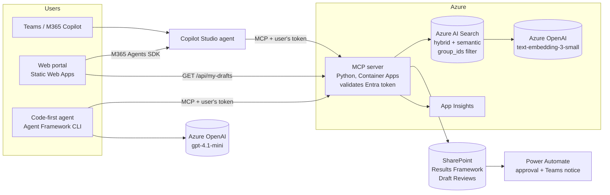

# Impact Evidence Assistant

A permission-aware AI assistant that helps program, M&E and communications staff find evidence in IREX reports and draft results-framework progress sections, with every claim cited and every submission reviewed by a person.

It runs where staff already work (Microsoft Teams, Microsoft 365 Copilot and a web portal) and only ever shows a user the documents they are allowed to see.

> Built on 20 public IREX documents (750 indexed passages). Four documents are marked restricted to test permission trimming. Results-framework targets are illustrative.

## What it does

| Task | How |
|---|---|
| Answer evidence questions | Hybrid (keyword + vector + semantic) search over IREX documents; answers cite *Title, page, URL* |
| Respect permissions | Search results are filtered by the signed-in user's Entra ID groups at query time |
| Refuse when unsure | Says "not in the documents" instead of guessing; declines out-of-scope requests |
| Draft progress sections | Reads indicators from a SharePoint results framework, finds evidence per indicator, writes a cited paragraph, reports "no evidence found" when there is none |
| Human review | Drafts are only submitted after the user confirms; a Power Automate approval routes them to a reviewer and notifies the author in Teams |
| Track my drafts | Web portal shows each user's submitted drafts and their review status |

## Architecture



The MCP server is the single gate to data. Every channel calls it with the **user's own token**, and it applies the security filter itself, so no channel can see more than the user may.

## Evaluation

49-question test set (39 answerable incl. 7 from restricted documents, 10 out-of-scope), run against the deployed server as two real users. Release gate: `eval/check_thresholds.py`.

| Metric | Result | Gate |
|---|---|---|
| Restricted documents leaked to all-staff user | **0** | 0 |
| Expected document in top 5 (hit@5) | **1.00** (MRR 0.987) | ≥ 0.85 |
| Restricted docs found by authorized reviewer | **1.00** | ≥ 0.85 |
| Groundedness (LLM judge, 1–5) | **5.0** | ≥ 4.0 |
| Correctness vs reference answer | **1.00** | ≥ 0.75 |
| Out-of-scope questions refused | **1.00** | ≥ 0.90 |

**Limits of this evaluation:** questions were generated from the indexed passages and then reviewed, so they share wording with the source and make retrieval easier than real staff questions. Answer metrics use the same instructions and retrieved passages as the agent but bypass Copilot Studio's orchestration. Next step: add hand-written questions from real users.

The eval also caught two real issues that were fixed: the agent wrote a poem when asked (fixed with a scope rule), and the code-first agent overclaimed progress and used non-IREX figures (fixed with stricter drafting rules).

## Repository map

| Folder | Purpose |
|---|---|
| `data/` | `sources.csv` (document catalogue + access group), `results_framework.csv` |
| `ingestion/` | Extract → chunk → embed → upload to Azure AI Search; index schema |
| `mcp_server/` | MCP server: `search_evidence`, `get_indicators`, `submit_draft_for_review`, `/api/my-drafts`; Entra token validation; tests |
| `agent/` | Shared agent instructions; exported Copilot Studio solution |
| `agent_code/` | Code-first agent (Microsoft Agent Framework) with in-code approval before submit |
| `portal/` | React + TypeScript web portal (MSAL sign-in, Web Chat, My drafts) |
| `eval/` | Test set, `run_eval.py`, `check_thresholds.py`, results |
| `scripts/` | Azure provisioning, smoke tests |
| `docs/` | Responsible AI card, security controls, decision notes, screenshots |
| `.github/workflows/` | Portal deploy to Azure Static Web Apps |

## Run it

```powershell
# tests (unit + permission integration against the real index)
uv run --env-file .env pytest -q

# evaluation and release gate
uv run python eval/run_eval.py
uv run python eval/check_thresholds.py

# portal locally (http://localhost:5173)
cd portal; npm install; npm start

# code-first agent
cd agent_code; uv sync; uv run python iea_agent.py --user <upn>
```

Environment values live in `.env` (see `.env.example`). Nothing secret is committed; services authenticate with managed identity or Entra ID.

## Technology

Microsoft Copilot Studio · Microsoft 365 Agents SDK · Microsoft Agent Framework · Model Context Protocol · Azure AI Search · Azure OpenAI · Azure Container Apps · Azure Container Registry · Azure Static Web Apps · Entra ID · SharePoint · Power Automate · Application Insights · Python (FastMCP, pytest, uv) · TypeScript/React · GitHub Actions

## Documentation

- [Responsible AI card](docs/responsible-ai.md)
- [Security controls](docs/security.md)
- [Decision notes](docs/decisions/)
